# Lab 2 – Prise en main et utilisation de Jenkins

[← Retour au sommaire](../README.md)

Objectif : construire un pipeline CI/CD avec Jenkins qui **clone le projet**, le **construit avec Maven** et le **conteneurise avec Docker**, le tout décrit dans un **Jenkinsfile**.

Prérequis déjà en place (Lab 1) : VM Ubuntu Server 26.04 avec Docker, Kubernetes (K3S) et Jenkins installé en service ; fork du projet [Amal356/Jenkins-Demo](https://github.com/Amal356/Jenkins-Demo) avec une page HTML modifiée.

---
## 0. Installation de Java et Jenkins

Jenkins a été installé en tant que service sur la VM pendant l'Activité 1 : installation de `openjdk-21-jre`, ajout du dépôt officiel Jenkins, activation du service, déverrouillage avec le mot de passe initial, installation des plugins suggérés et création du compte administrateur.

Compte rendu et captures : [cv-devsecops/04-jenkins](https://github.com/Amal356/cv-devsecops/tree/main/04-jenkins)

## 1. Ajouter les plugins

Administrer Jenkins → **Plugins** → **Plugins disponibles** : **Kubernetes CLI**, **Maven Integration**, **Docker** et **Docker Pipeline**.

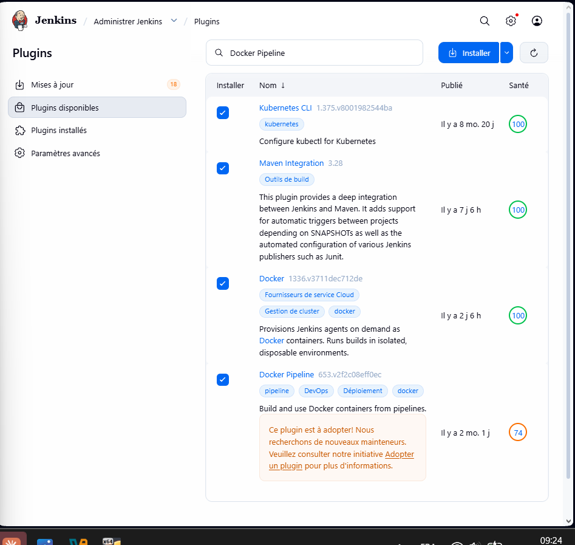

Le plugin Docker dépend de nouvelles versions de plugins déjà installés (Jackson 2 API, commons-lang3, bouncycastle) : son activation a échoué jusqu'au **redémarrage de Jenkins** (`http://localhost:8080/safeRestart`). Après redémarrage, tous les plugins sont actifs :

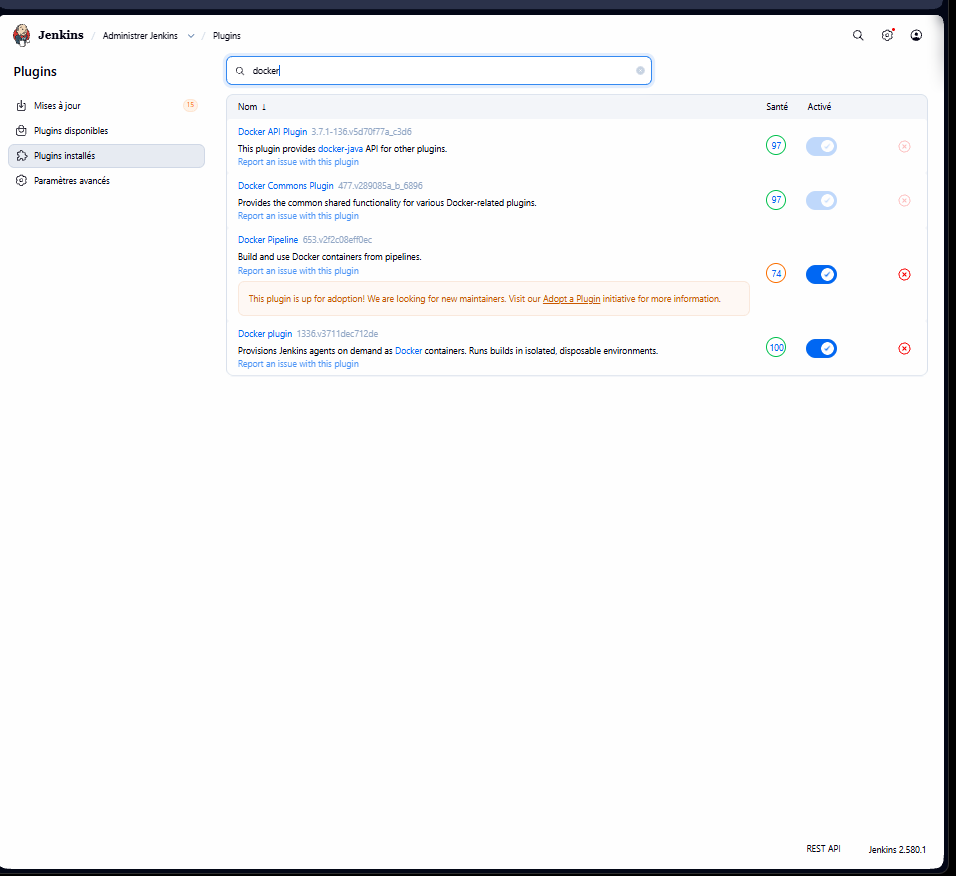

## 2. Configurer JDK, Maven et Docker

Administrer Jenkins → **Tools** (Configuration globale des outils).

### JDK

| Champ | Valeur |
|---|---|
| Nom | `jdk21` |
| JAVA_HOME | `/usr/lib/jvm/java-21-openjdk-amd64` |
| Install automatically | non |

Comme l'indique la note de l'énoncé, sur Linux il suffit d'indiquer le chemin du JDK installé (pas de compte Oracle nécessaire). Jenkins signalait d'abord que ce dossier n'était pas un JDK : la VM n'avait que le **JRE** (pas de `javac`). Correction :

```bash
sudo apt install -y openjdk-21-jdk-headless
javac -version     # javac 21.0.12.1
```

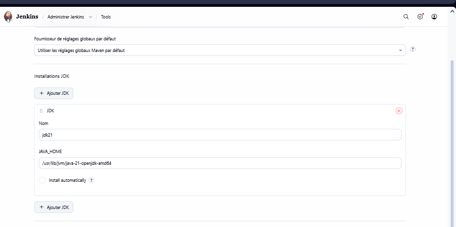

### Maven

| Champ | Valeur |
|---|---|
| Nom | `maven-3.9` |
| Install automatically | oui → Install from Apache, version **3.9.16** |

Ce nom doit être identique à celui utilisé dans le Jenkinsfile (`tool 'maven-3.9'`).

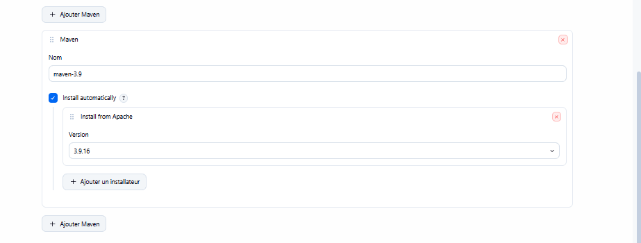

### Docker

| Champ | Valeur |
|---|---|
| Nom | `MyDocker` |
| Installation root | `/usr` (Docker est déjà installé : `/usr/bin/docker`) |
| Install automatically | non |

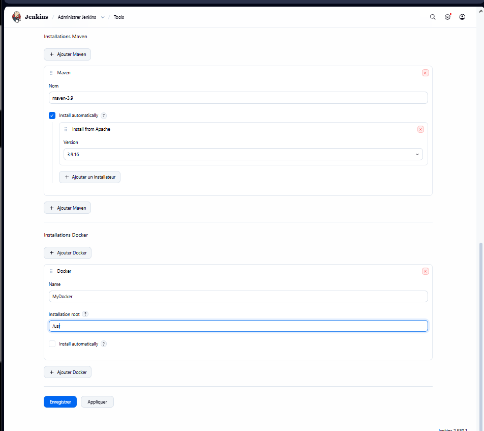

## 3. Configurer le fournisseur cloud Docker

Administrer Jenkins → **Clouds** → **New cloud** → type **Docker**, nom `docker`.

| Champ | Valeur |
|---|---|
| Docker Host URI | `unix:///var/run/docker.sock` |
| Enabled | oui |

**Test Connection** : `Version = 29.8.2, API Version = 1.56`.

**Choix de sécurité :** l'énoncé propose le port TCP **2375**. Sans TLS, ce port n'est ni chiffré ni authentifié : toute personne qui peut l'atteindre contrôle Docker, donc la machine en root. J'utilise à la place le **socket Unix local**, qui offre la même connexion sans rien exposer sur le réseau. L'utilisateur `jenkins` y a accès car il appartient au groupe `docker`.

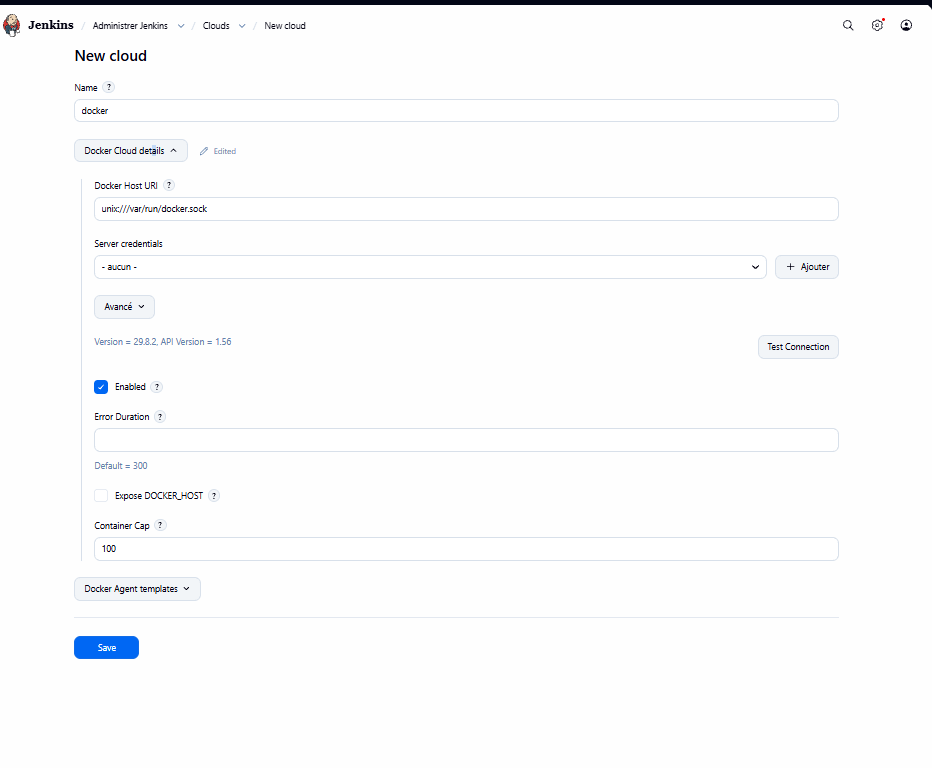

## 4. Jenkinsfile

Le Jenkinsfile présent dans le fork (version avec notifications Slack) est remplacé par celui de l'énoncé, adapté :

```groovy
node {
    def mvnHome = tool 'maven-3.9'
    def dockerImageTag = "devopsexample:${env.BUILD_NUMBER}"

    stage('Clone Repo') {
        git branch: 'main', url: 'https://github.com/Amal356/Jenkins-Demo.git'
    }

    stage('Build Project') {
        sh "'${mvnHome}/bin/mvn' clean package"
    }

    stage('Initialize Docker') {
        def dockerHome = tool 'MyDocker'
        env.PATH = "${dockerHome}/bin:${env.PATH}"
    }

    stage('Build Docker Image') {
        sh "docker build -t ${dockerImageTag} ."
    }

    stage('Deploy Docker Image') {
        echo "Docker Image Tag Name: ${dockerImageTag}"
        sh "docker rm -f devopsexample || true"
        sh "docker run --name devopsexample -d -p 2222:2222 ${dockerImageTag}"
    }
}
```

| Stage | Rôle |
|---|---|
| Clone Repo | clone mon dépôt GitHub (branche `main`) |
| Build Project | build Maven avec l'outil `maven-3.9` configuré dans Jenkins |
| Initialize Docker | ajoute l'outil `MyDocker` au `PATH` |
| Build Docker Image | construit l'image avec un tag unique par build (`devopsexample:1`, `:2`…) |
| Deploy Docker Image | supprime l'ancien conteneur s'il existe, puis lance le nouveau sur le port 2222 |

Adaptations par rapport à l'énoncé : nom de l'outil Maven (`maven-3.9`), URL de mon dépôt, guillemets typographiques corrigés (ils provoquent une erreur Groovy), et `docker rm -f devopsexample || true` pour que les builds suivants n'échouent pas sur « name already in use ».

```bash
git add Jenkinsfile
git commit -m "Lab 2 : Jenkinsfile (clone, build Maven, image et conteneur Docker)"
git push
```

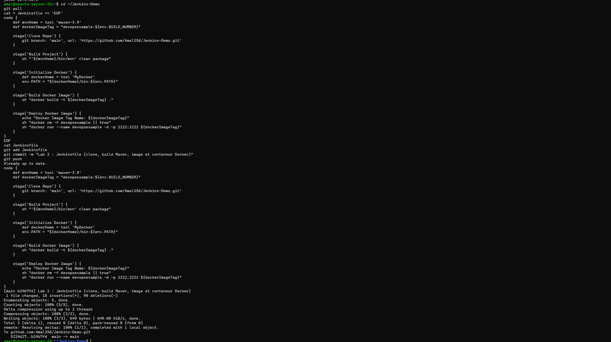

## 5. Créer le pipeline

Nouveau Item → `lab2-pipeline` → type **Pipeline**.

**Général → GitHub project** : `https://github.com/Amal356/Jenkins-Demo/`

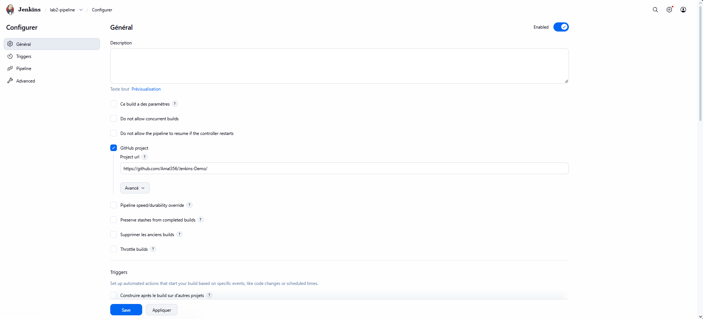

**Pipeline** :

| Champ | Valeur |
|---|---|
| Definition | Pipeline script from SCM |
| SCM | Git |
| Repository URL | `https://github.com/Amal356/Jenkins-Demo.git` |
| Branch Specifier | `*/main` |
| Script Path | `Jenkinsfile` |

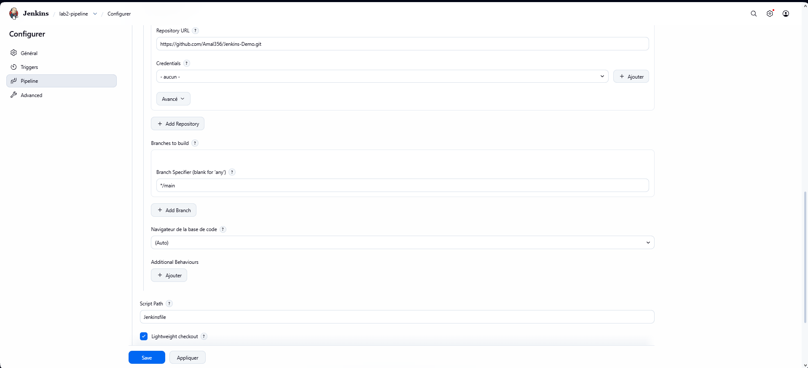

## 6. Lancer le pipeline

**Lancer un build** : les 5 stages réussissent en 35 secondes.

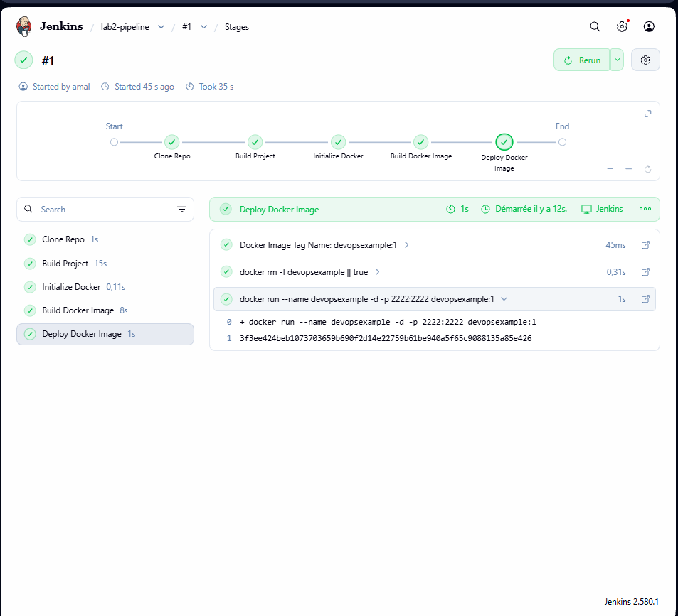

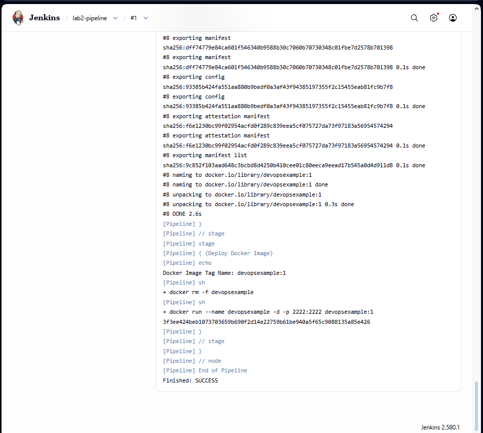

L'application déployée par Jenkins dans le conteneur `devopsexample` est accessible sur le port 2222 de la VM, soit `http://localhost:8082` depuis la machine physique (redirection VirtualBox 8082 → 2222) :

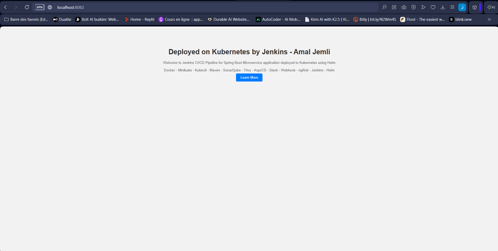

[← Retour au sommaire](../README.md)
